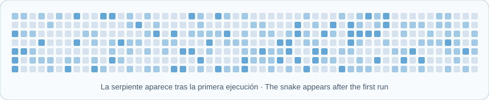
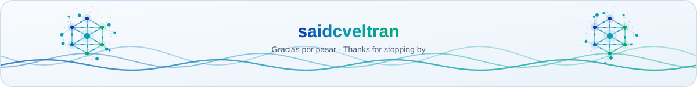

<div align="center">

<picture>
  <source media="(prefers-color-scheme: dark)" srcset="assets/hero-dark.svg">
  <source media="(prefers-color-scheme: light)" srcset="assets/hero-light.svg">
  
</picture>

[Proyectos](#proyectos) · [Stack](#stack) · [Sobre mí](#sobre-mí) · [Actividad](#actividad) · [Contacto](#contacto)

English version below, inside the collapsible section.

</div>

## Proyectos

Todo lo que hago vive bajo el nombre **AIskaron**.

<p align="center">
  <a href="https://github.com/saidcveltran/normawatch-boe"><picture>
    <source media="(prefers-color-scheme: dark)" srcset="assets/cards/normawatch-dark.svg">
    <source media="(prefers-color-scheme: light)" srcset="assets/cards/normawatch-light.svg">
    
  </picture></a>
  <picture>
    <source media="(prefers-color-scheme: dark)" srcset="assets/cards/duckys-dark.svg">
    <source media="(prefers-color-scheme: light)" srcset="assets/cards/duckys-light.svg">
    
  </picture>
  <picture>
    <source media="(prefers-color-scheme: dark)" srcset="assets/cards/aiskaron-dark.svg">
    <source media="(prefers-color-scheme: light)" srcset="assets/cards/aiskaron-light.svg">
    
  </picture>
  <picture>
    <source media="(prefers-color-scheme: dark)" srcset="assets/cards/robots-kinora-dark.svg">
    <source media="(prefers-color-scheme: light)" srcset="assets/cards/robots-kinora-light.svg">
    
  </picture>
</p>

- **NormaWatch**: cada día, las nuevas disposiciones generales del BOE (y, opcionalmente, oposiciones y los boletines de Andalucía, Galicia y Cataluña) en JSON y tabla, con aviso opcional por email, Telegram o Slack. Solo metadatos y enlaces oficiales. [Código](https://github.com/saidcveltran/normawatch-boe) · [Apify Store](https://apify.com/saidcveltran/normawatch-boe)
- **DUCKYS**: bot de música para Discord con `/play`, autoplay, muchos idiomas y panel web. El código es privado.
- **aiskaron.com**: el sitio donde reuniré todo. Próximamente.
- **Robots** y **Kinora**: en desarrollo, aún sin enlaces públicos.

## Stack

<picture>
  <source media="(prefers-color-scheme: dark)" srcset="assets/stack-dark.svg">
  <source media="(prefers-color-scheme: light)" srcset="assets/stack-light.svg">
  
</picture>

## Sobre mí

Desarrollo software bajo el nombre **AIskaron**: herramientas de datos abiertos, bots y juegos. Me gusta convertir fuentes públicas difíciles de seguir en algo que se pueda consultar, automatizar y compartir, y construir cosas para jugar y para animar.

```js
const saidcveltran = {
  projects: "AIskaron",
  focus: ["open data", "Discord bots", "3D games", "animation tools"],
  stack: ["TypeScript", "Node.js", "Python", "Godot", "Blender"],
  shipped: "NormaWatch v1.8.0 on the Apify Store",
  building: ["Robots", "Kinora", "aiskaron.com"],
};
```

## Actividad

<picture>
  <source media="(prefers-color-scheme: dark)" srcset="profile-3d-contrib/profile-night-green.svg">
  <source media="(prefers-color-scheme: light)" srcset="profile-3d-contrib/profile-green.svg">
  
</picture>

<picture>
  <source media="(prefers-color-scheme: dark)" srcset="snake/github-snake-dark.svg">
  <source media="(prefers-color-scheme: light)" srcset="snake/github-snake.svg">
  
</picture>

## Contacto

Mi código está en [GitHub](https://github.com/saidcveltran) y mis Actors en la [Apify Store](https://apify.com/saidcveltran).

<details>
<summary><b>English version</b></summary>

### Projects

Everything I make lives under the name **AIskaron**.

- **NormaWatch** (published, v1.8.0): a free Apify Actor that delivers, every day, the new general provisions of Spain's BOE (optionally also oposiciones and the Andalucía, Galicia and Cataluña gazettes) as JSON and a table, with optional email, Telegram or Slack notices. Metadata and official links only. [Code](https://github.com/saidcveltran/normawatch-boe) · [Apify Store](https://apify.com/saidcveltran/normawatch-boe)
- **DUCKYS** (private): a Discord music bot with a `/play` slash command, autoplay, many languages and a web panel. The code is private.
- **aiskaron.com** (coming soon): the personal hub where all the projects will live.
- **Robots** and **Kinora** (in development): a 3D robot-combat game in Godot with breakable parts and an enemy that learns, and an open-source template to animate characters in Blender. No public links yet.

### Stack

TypeScript, JavaScript, Node.js, Python, Godot, Blender, Cloudflare, Apify, Git and Discord.

### About me

I develop software under the name **AIskaron**: open-data tools, bots and games. I like turning public sources that are hard to follow into something you can query, automate and share, and building things to play with and to animate.

```js
const saidcveltran = {
  projects: "AIskaron",
  focus: ["open data", "Discord bots", "3D games", "animation tools"],
  stack: ["TypeScript", "Node.js", "Python", "Godot", "Blender"],
  shipped: "NormaWatch v1.8.0 on the Apify Store",
  building: ["Robots", "Kinora", "aiskaron.com"],
};
```

### Contact

My code is on [GitHub](https://github.com/saidcveltran) and my Actors are on the [Apify Store](https://apify.com/saidcveltran).

</details>

<div align="center">

<picture>
  <source media="(prefers-color-scheme: dark)" srcset="assets/footer-dark.svg">
  <source media="(prefers-color-scheme: light)" srcset="assets/footer-light.svg">
  
</picture>

</div>
