<picture>
  <source media="(prefers-color-scheme: dark)" srcset="assets/logo-dark.png">
  
</picture>

# saidcveltran

Desarrollo herramientas de datos abiertos, bots y juegos.

Construyo herramientas para que los datos oficiales y públicos sean fáciles de buscar y de seguir con avisos. También hago bots de Discord y juegos y animación en 3D.

Proyectos bajo el nombre AIskaron · [Apify Store](https://apify.com/saidcveltran) · [dev.to](https://dev.to/saidcveltran) · [English](#english)

## Proyectos

**[NormaWatch](https://github.com/saidcveltran/normawatch-boe)** · Publicado · v1.8.0 · [Apify Store](https://apify.com/saidcveltran/normawatch-boe) 
Cada día, las nuevas disposiciones del BOE y de los boletines de Andalucía, Galicia y Cataluña, en JSON y tabla, con aviso opcional. Ahora: más boletines autonómicos. 
TypeScript · Apify

**DUCKYS** · Privado 
Bot de música para Discord, con /play, autoplay y panel web. 
Python

**aiskaron.com** · Próximamente 
El sitio donde reuniré todos los proyectos. 
Astro · Cloudflare

**Kinora** · En desarrollo 
Plantilla de código abierto para animar personajes en Blender. 
Blender · Python

## Últimamente

<!-- lately-es:start -->
- Versión [normawatch-boe v1.8.0](https://github.com/saidcveltran/normawatch-boe/releases/tag/v1.8.0) · 2026-10-20
- PR aceptado en [GeiserX/awesome-spain\#78](https://github.com/GeiserX/awesome-spain/pull/78): Menciona el BOJA y el DOG en la entrada de normawatch-boe · 2026-10-20
- PR aceptado en [GeiserX/awesome-spain\#76](https://github.com/GeiserX/awesome-spain/pull/76): Añade normawatch-boe, un Actor de Apify que lista las nueva… · 2026-10-20
<!-- lately-es:end -->

## Con qué trabajo

**Datos abiertos** — TypeScript, Node.js, Apify 
**Bots** — Python, Discord 
**Juegos y animación** — Godot, Blender 
**Web** — Astro, Cloudflare

## Actividad

<picture>
  <source media="(prefers-color-scheme: dark)" srcset="assets/activity-dark.svg">
  
</picture>

Incluye los repos privados (solo el número). Se actualiza cada día.

English version

I build tools that make official, public data easy to search and to follow with alerts. I also make Discord bots and 3D games and animation. Projects under the name AIskaron · [Apify Store](https://apify.com/saidcveltran) · [dev.to](https://dev.to/saidcveltran)

### Projects

**[NormaWatch](https://github.com/saidcveltran/normawatch-boe)** · Published · v1.8.0 · [Apify Store](https://apify.com/saidcveltran/normawatch-boe) 
Every day, the new provisions of Spain's BOE and of the Andalucía, Galicia and Cataluña gazettes, as JSON and a table, with optional notices. Now: more regional gazettes. 
TypeScript · Apify

**DUCKYS** · Private 
A Discord music bot with /play, autoplay and a web panel. 
Python

**aiskaron.com** · Coming soon 
The site where I will bring all the projects together. 
Astro · Cloudflare

**Kinora** · In development 
An open-source template to animate characters in Blender. 
Blender · Python

### Lately

<!-- lately-en:start -->
- Release [normawatch-boe v1.8.0](https://github.com/saidcveltran/normawatch-boe/releases/tag/v1.8.0) · 2026-10-20
- Merged PR to [GeiserX/awesome-spain\#78](https://github.com/GeiserX/awesome-spain/pull/78): Menciona el BOJA y el DOG en la entrada de normawatch-boe · 2026-10-20
- Merged PR to [GeiserX/awesome-spain\#76](https://github.com/GeiserX/awesome-spain/pull/76): Añade normawatch-boe, un Actor de Apify que lista las nueva… · 2026-10-20
<!-- lately-en:end -->

### What I work with

**Open data** — TypeScript, Node.js, Apify 
**Bots** — Python, Discord 
**Games and animation** — Godot, Blender 
**Web** — Astro, Cloudflare

### Activity

The heatmap above counts private repositories too (number only) and is updated every day.

