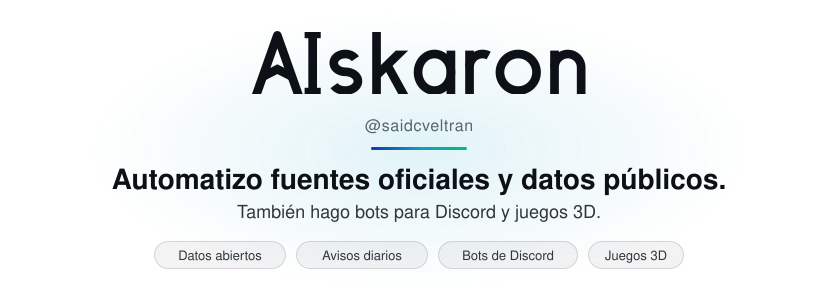
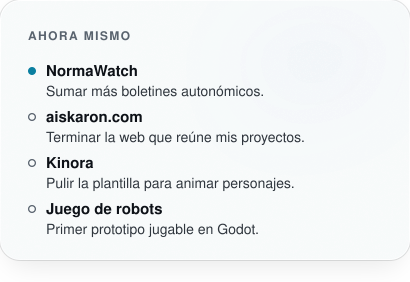
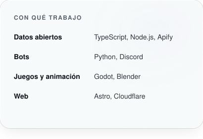
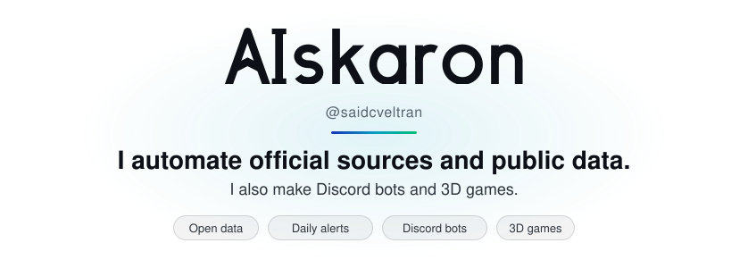
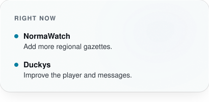
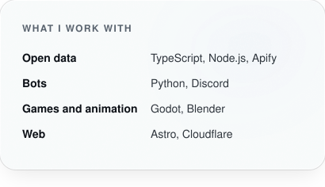

<picture>
  <source media="(prefers-color-scheme: dark)" srcset="assets/banner-w2-dark.svg">
  
</picture>

### Sobre mí

AIskaron es el nombre de mis proyectos, reunidos en [aiskaron.com](https://aiskaron.com). Convierto boletines oficiales y webs públicas en datos limpios, listos para usar sin copiar nada a mano. En mis ratos libres hago bots para Discord, animaciones en Blender y juegos en Godot.

### Contacto

<a href="https://github.com/saidcveltran"><picture><source media="(prefers-color-scheme: dark)" srcset="assets/contact-github-dark.svg"></picture></a> <a href="https://apify.com/saidcveltran"><picture><source media="(prefers-color-scheme: dark)" srcset="assets/contact-apify-dark.svg"></picture></a> <a href="https://dev.to/saidcveltran"><picture><source media="(prefers-color-scheme: dark)" srcset="assets/contact-devto-dark.svg"></picture></a> <a href="https://www.producthunt.com/@saidcveltran"><picture><source media="(prefers-color-scheme: dark)" srcset="assets/contact-producthunt-dark.svg"></picture></a> <a href="https://saidcveltran.itch.io"><picture><source media="(prefers-color-scheme: dark)" srcset="assets/contact-itchio-dark.svg"></picture></a>

<picture>
  <source media="(prefers-color-scheme: dark)" srcset="assets/now-dark.svg">
  
</picture> <picture>
  <source media="(prefers-color-scheme: dark)" srcset="assets/stack-dark.svg">
  
</picture>

<picture>
  <source media="(prefers-color-scheme: dark)" srcset="assets/projects-dark.svg">
  
</picture>

<a href="https://aiskaron.com">aiskaron.com</a> · <a href="https://duckys.aiskaron.com">Duckys</a> · NormaWatch: <a href="https://github.com/saidcveltran/normawatch-boe">repositorio</a> · <a href="https://apify.com/saidcveltran/normawatch-boe">Apify Store</a> · <a href="https://saidcveltran.itch.io">itch.io</a> · <a href="https://dev.to/saidcveltran">dev.to</a> · <a href="#english">English</a>

## Últimamente

<!-- lately-es:start -->
- Versión [normawatch-boe v1.8.0](https://github.com/saidcveltran/normawatch-boe/releases/tag/v1.8.0) · 2026-10-20
- PR aceptado en [GeiserX/awesome-spain\#78](https://github.com/GeiserX/awesome-spain/pull/78): Menciona el BOJA y el DOG en la entrada de normawatch-boe · 2026-10-20
- PR aceptado en [GeiserX/awesome-spain\#76](https://github.com/GeiserX/awesome-spain/pull/76): Añade normawatch-boe, un Actor de Apify que lista las nueva… · 2026-10-20
<!-- lately-es:end -->

English version

<picture>
  <source media="(prefers-color-scheme: dark)" srcset="assets/banner-w2-en-dark.svg">
  
</picture>

### About me

AIskaron is the name of my projects, all gathered at [aiskaron.com](https://aiskaron.com). I turn official bulletins and public websites into clean data, ready to use without copying anything by hand. In my spare time I make Discord bots, Blender animations and Godot games.

### Contact

<a href="https://github.com/saidcveltran"><picture><source media="(prefers-color-scheme: dark)" srcset="assets/contact-github-dark.svg"></picture></a> <a href="https://apify.com/saidcveltran"><picture><source media="(prefers-color-scheme: dark)" srcset="assets/contact-apify-dark.svg"></picture></a> <a href="https://dev.to/saidcveltran"><picture><source media="(prefers-color-scheme: dark)" srcset="assets/contact-devto-dark.svg"></picture></a> <a href="https://www.producthunt.com/@saidcveltran"><picture><source media="(prefers-color-scheme: dark)" srcset="assets/contact-producthunt-dark.svg"></picture></a> <a href="https://saidcveltran.itch.io"><picture><source media="(prefers-color-scheme: dark)" srcset="assets/contact-itchio-dark.svg"></picture></a>

<picture>
  <source media="(prefers-color-scheme: dark)" srcset="assets/now-en-dark.svg">
  
</picture> <picture>
  <source media="(prefers-color-scheme: dark)" srcset="assets/stack-en-dark.svg">
  
</picture>

<picture>
  <source media="(prefers-color-scheme: dark)" srcset="assets/projects-en-dark.svg">
  
</picture>

<a href="https://aiskaron.com/en/">aiskaron.com</a> · <a href="https://duckys.aiskaron.com/?lang=en">Duckys</a> · NormaWatch: <a href="https://github.com/saidcveltran/normawatch-boe">repository</a> · <a href="https://apify.com/saidcveltran/normawatch-boe">Apify Store</a> · <a href="https://saidcveltran.itch.io">itch.io</a> · <a href="https://dev.to/saidcveltran">dev.to</a>

## Lately

<!-- lately-en:start -->
- Release [normawatch-boe v1.8.0](https://github.com/saidcveltran/normawatch-boe/releases/tag/v1.8.0) · 2026-10-20
- Merged PR to [GeiserX/awesome-spain\#78](https://github.com/GeiserX/awesome-spain/pull/78): Menciona el BOJA y el DOG en la entrada de normawatch-boe · 2026-10-20
- Merged PR to [GeiserX/awesome-spain\#76](https://github.com/GeiserX/awesome-spain/pull/76): Añade normawatch-boe, un Actor de Apify que lista las nueva… · 2026-10-20
<!-- lately-en:end -->

