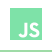
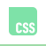

I am an independent software developer. I build bots, automation and web tools, from design to release. My projects share the name AIskaron: [aiskaron.com](https://aiskaron.com).

<h3></h3>

Public repositories:

<!-- live:repos:start -->

<!-- live:repos:end -->

<h3></h3>

<!-- live:languages:start -->

<!-- live:languages:end -->

<h3></h3>

<!-- live:socials:start -->
<table>
<tr>
<td valign="top">
 

</td>
<td valign="top">
 

</td>
</tr>
</table>
<!-- live:socials:end -->

<h3></h3>

[Ask a question about a project](https://github.com/saidcveltran/saidcveltran/issues/new?template=question.yml). It opens an issue with the form already prepared.

Versión en español

Soy desarrollador de software independiente. Hago bots, automatización y herramientas web, del diseño a la publicación. Mis proyectos comparten el nombre AIskaron: [aiskaron.com](https://aiskaron.com).

**Proyectos.** [Duckys](https://duckys.aiskaron.com/) es un bot de música para Discord; al pulsar su tarjeta se abre el proyecto. Sus cifras (servidores y pistas reproducidas) salen de su página pública y las barras son solo decoración. [Resma](https://resma.aiskaron.com) son herramientas de PDF en el navegador (unir PDF y pasar JPG a PDF), gratis y sin subir nada; su tarjeta no lleva cifras porque no tiene contador público. Debajo, una tarjeta por cada repositorio público (Resma incluido: tiene su repositorio abierto), con su última versión, la descripción del propio repositorio, el lenguaje y la fecha del último push. Todo se redibuja solo, a partir de datos públicos; nada se escribe a mano.

**Lenguajes.** Cada icono es un lenguaje usado en alguno de mis proyectos, públicos o privados; la lista se calcula en mi equipo y solo contiene los nombres de los lenguajes.

**Contacto.** Los botones de «Find me» tienen dos grupos: AIskaron (los proyectos) y saidcveltran.dev (yo). Para preguntar sobre un proyecto, [abre una issue](https://github.com/saidcveltran/saidcveltran/issues/new?template=question.yml) con el formulario ya preparado.

