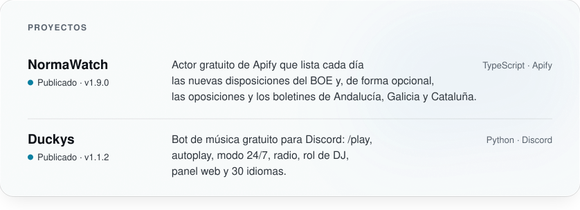
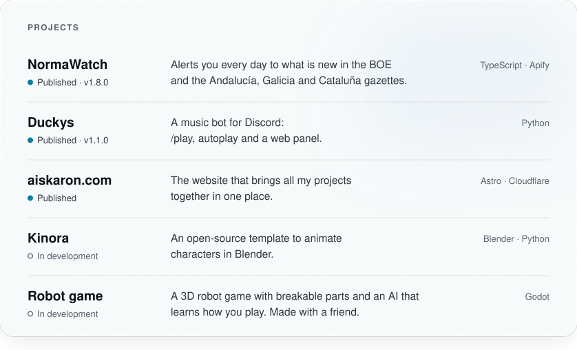

<picture>
  <source media="(prefers-color-scheme: dark)" srcset="assets/banner-w2-dark.svg">
  
</picture>

### Sobre mí

AIskaron es el nombre de mis proyectos, reunidos en [aiskaron.com](https://aiskaron.com). Soy desarrollador de software independiente y hago bots, automatizaciones y herramientas web, diseñados y construidos de principio a fin. Mis dos proyectos actuales son NormaWatch, que convierte boletines oficiales en datos limpios y listos para usar, y Duckys, un bot de música para Discord.

### Contacto

<a href="https://github.com/saidcveltran"><picture><source media="(prefers-color-scheme: dark)" srcset="assets/contact-github-dark.svg"></picture></a> <a href="https://apify.com/saidcveltran"><picture><source media="(prefers-color-scheme: dark)" srcset="assets/contact-apify-dark.svg"></picture></a> <a href="https://dev.to/saidcveltran"><picture><source media="(prefers-color-scheme: dark)" srcset="assets/contact-devto-dark.svg"></picture></a> <a href="https://www.producthunt.com/@saidcveltran"><picture><source media="(prefers-color-scheme: dark)" srcset="assets/contact-producthunt-dark.svg"></picture></a>

<a href="https://x.com/aiskaron"><picture><source media="(prefers-color-scheme: dark)" srcset="assets/contact-x-dark.svg"></picture></a> <a href="https://www.tiktok.com/@aiskaron"><picture><source media="(prefers-color-scheme: dark)" srcset="assets/contact-tiktok-dark.svg"></picture></a> <a href="https://www.instagram.com/aiskaron"><picture><source media="(prefers-color-scheme: dark)" srcset="assets/contact-instagram-dark.svg"></picture></a>

<picture>
  <source media="(prefers-color-scheme: dark)" srcset="assets/now-dark.svg">
  
</picture> <picture>
  <source media="(prefers-color-scheme: dark)" srcset="assets/stack-dark.svg">
  
</picture>

<picture>
  <source media="(prefers-color-scheme: dark)" srcset="assets/projects-dark.svg">
  
</picture>

<a href="https://aiskaron.com">aiskaron.com</a> · <a href="https://duckys.aiskaron.com">Duckys</a> · NormaWatch: <a href="https://github.com/saidcveltran/normawatch-boe">repositorio</a> · <a href="https://apify.com/saidcveltran/normawatch-boe">Apify Store</a> · <a href="https://dev.to/saidcveltran">dev.to</a> · <a href="#english">English</a>

English version

<picture>
  <source media="(prefers-color-scheme: dark)" srcset="assets/banner-w2-en-dark.svg">
  
</picture>

### About me

AIskaron is the name of my projects, all gathered at [aiskaron.com](https://aiskaron.com). I am an independent software developer: I make bots, automation and web tools, designed and built end to end. My two current projects are NormaWatch, which turns official bulletins into clean, ready-to-use data, and Duckys, a music bot for Discord.

### Contact

<a href="https://github.com/saidcveltran"><picture><source media="(prefers-color-scheme: dark)" srcset="assets/contact-github-dark.svg"></picture></a> <a href="https://apify.com/saidcveltran"><picture><source media="(prefers-color-scheme: dark)" srcset="assets/contact-apify-dark.svg"></picture></a> <a href="https://dev.to/saidcveltran"><picture><source media="(prefers-color-scheme: dark)" srcset="assets/contact-devto-dark.svg"></picture></a> <a href="https://www.producthunt.com/@saidcveltran"><picture><source media="(prefers-color-scheme: dark)" srcset="assets/contact-producthunt-dark.svg"></picture></a>

<a href="https://x.com/aiskaron"><picture><source media="(prefers-color-scheme: dark)" srcset="assets/contact-x-dark.svg"></picture></a> <a href="https://www.tiktok.com/@aiskaron"><picture><source media="(prefers-color-scheme: dark)" srcset="assets/contact-tiktok-dark.svg"></picture></a> <a href="https://www.instagram.com/aiskaron"><picture><source media="(prefers-color-scheme: dark)" srcset="assets/contact-instagram-dark.svg"></picture></a>

<picture>
  <source media="(prefers-color-scheme: dark)" srcset="assets/now-en-dark.svg">
  
</picture> <picture>
  <source media="(prefers-color-scheme: dark)" srcset="assets/stack-en-dark.svg">
  
</picture>

<picture>
  <source media="(prefers-color-scheme: dark)" srcset="assets/projects-en-dark.svg">
  
</picture>

<a href="https://aiskaron.com/en/">aiskaron.com</a> · <a href="https://duckys.aiskaron.com/?lang=en">Duckys</a> · NormaWatch: <a href="https://github.com/saidcveltran/normawatch-boe">repository</a> · <a href="https://apify.com/saidcveltran/normawatch-boe">Apify Store</a> · <a href="https://dev.to/saidcveltran">dev.to</a>

