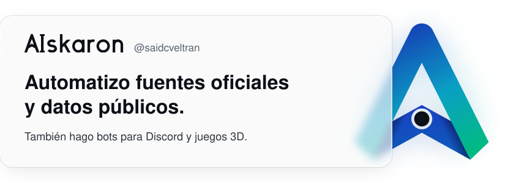
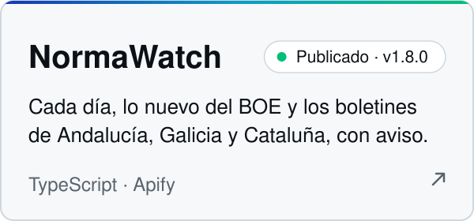
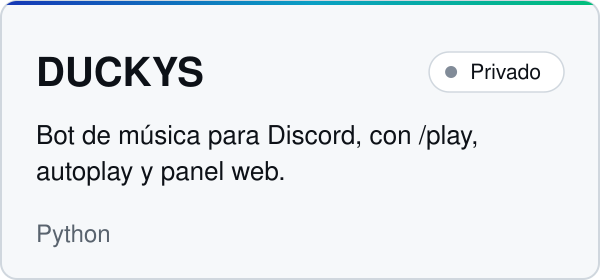
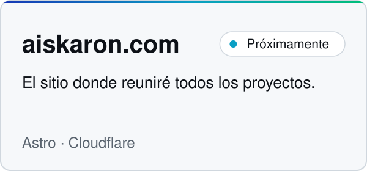
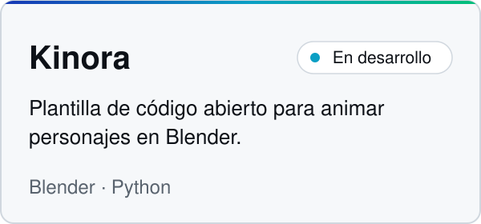
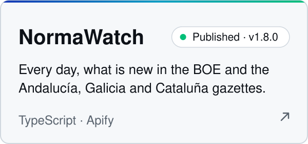
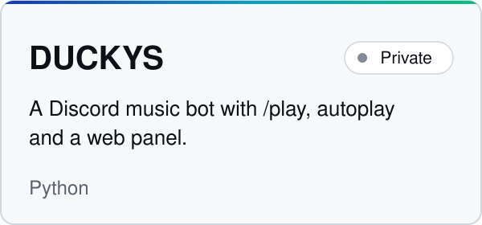
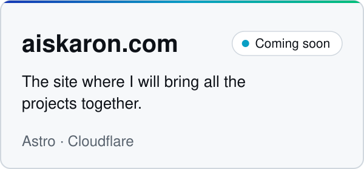
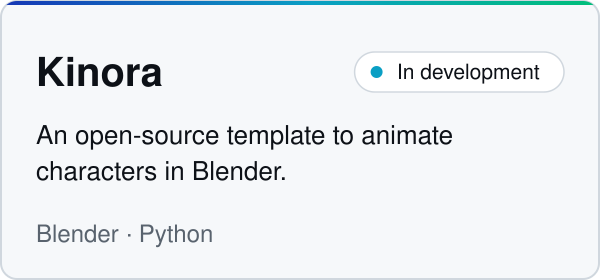

<picture>
  <source media="(prefers-color-scheme: dark)" srcset="assets/banner-dark.svg">
  
</picture>

Construyo herramientas para que los datos oficiales y públicos sean fáciles de buscar y de seguir con avisos. También hago bots de Discord y juegos y animación en 3D.
  
Proyectos bajo el nombre AIskaron · <a href="https://apify.com/saidcveltran">Apify Store</a> · <a href="https://dev.to/saidcveltran">dev.to</a> · <a href="#english">English</a>

## Proyectos

<picture><source media="(prefers-color-scheme: dark)" srcset="assets/card-normawatch-dark.svg"></picture>
<picture><source media="(prefers-color-scheme: dark)" srcset="assets/card-duckys-dark.svg"></picture>
 
<picture><source media="(prefers-color-scheme: dark)" srcset="assets/card-aiskaron-dark.svg"></picture>
<picture><source media="(prefers-color-scheme: dark)" srcset="assets/card-kinora-dark.svg"></picture>

NormaWatch también está en la <a href="https://apify.com/saidcveltran/normawatch-boe">Apify Store</a>.

## Últimamente

<!-- lately-es:start -->
- Versión [normawatch-boe v1.8.0](https://github.com/saidcveltran/normawatch-boe/releases/tag/v1.8.0) · 2026-10-20
- PR aceptado en [GeiserX/awesome-spain\#78](https://github.com/GeiserX/awesome-spain/pull/78): Menciona el BOJA y el DOG en la entrada de normawatch-boe · 2026-10-20
- PR aceptado en [GeiserX/awesome-spain\#76](https://github.com/GeiserX/awesome-spain/pull/76): Añade normawatch-boe, un Actor de Apify que lista las nueva… · 2026-10-20
<!-- lately-es:end -->

## Con qué trabajo

**Datos abiertos** — TypeScript, Node.js, Apify 
**Bots** — Python, Discord 
**Juegos y animación** — Godot, Blender 
**Web** — Astro, Cloudflare

English version

I build tools that make official, public data easy to search and to follow with alerts. I also make Discord bots and 3D games and animation.

Projects under the name AIskaron · <a href="https://apify.com/saidcveltran">Apify Store</a> · <a href="https://dev.to/saidcveltran">dev.to</a>

### Projects

<picture><source media="(prefers-color-scheme: dark)" srcset="assets/card-normawatch-en-dark.svg"></picture>
<picture><source media="(prefers-color-scheme: dark)" srcset="assets/card-duckys-en-dark.svg"></picture>
 
<picture><source media="(prefers-color-scheme: dark)" srcset="assets/card-aiskaron-en-dark.svg"></picture>
<picture><source media="(prefers-color-scheme: dark)" srcset="assets/card-kinora-en-dark.svg"></picture>

NormaWatch is also on the <a href="https://apify.com/saidcveltran/normawatch-boe">Apify Store</a>.

### Lately

<!-- lately-en:start -->
- Release [normawatch-boe v1.8.0](https://github.com/saidcveltran/normawatch-boe/releases/tag/v1.8.0) · 2026-10-20
- Merged PR to [GeiserX/awesome-spain\#78](https://github.com/GeiserX/awesome-spain/pull/78): Menciona el BOJA y el DOG en la entrada de normawatch-boe · 2026-10-20
- Merged PR to [GeiserX/awesome-spain\#76](https://github.com/GeiserX/awesome-spain/pull/76): Añade normawatch-boe, un Actor de Apify que lista las nueva… · 2026-10-20
<!-- lately-en:end -->

### What I work with

**Open data** — TypeScript, Node.js, Apify 
**Bots** — Python, Discord 
**Games and animation** — Godot, Blender 
**Web** — Astro, Cloudflare

